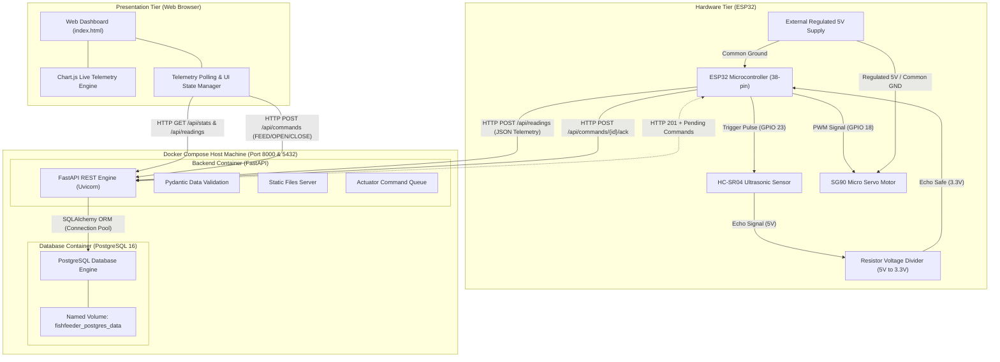
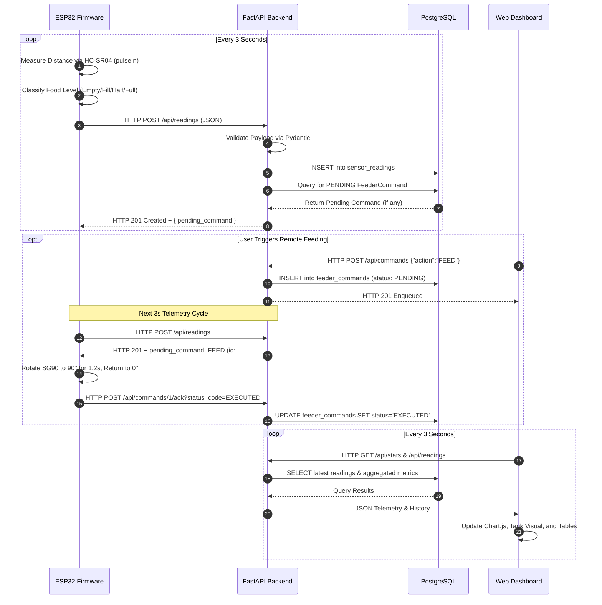
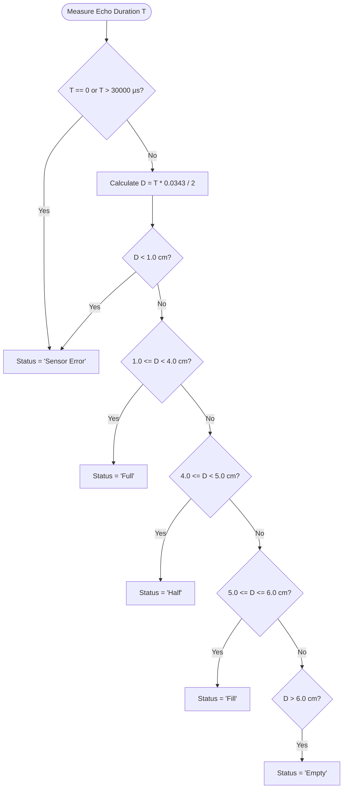

# IoT-Based Automatic Fish Feeder with Real-Time Monitoring Dashboard

**Academic Degree:** Master of Computer Applications (MCA)  
**Subject:** Internet of Things & Cloud Application Development  
**Submission Type:** Project Laboratory Report / Capstone Assignment  

---

## 1. Title
**IoT-Based Automatic Fish Feeder with Real-Time Telemetry and Cloud Monitoring Dashboard**

---

## 2. Abstract
Aquaculture management and domestic aquarium maintenance require consistent, regulated feeding schedules and continuous monitoring of food supply levels to prevent fish starvation or water pollution caused by overfeeding. This project presents a full-stack, containerized Internet of Things (IoT) solution featuring an ESP32 microcontroller, an HC-SR04 ultrasonic distance sensor, and an SG90 micro-servo motor integrated with a production-grade FastAPI backend, PostgreSQL relational database, and an interactive real-time web dashboard. The ultrasonic sensor measures the distance from the top of the feed container to the food surface, classifying capacity into four operational states (`Empty`, `Fill`, `Half`, `Full`) alongside sensor error detection. Telemetry data is serialized into JSON and transmitted over Wi-Fi via HTTP POST requests every three seconds. A containerized backend orchestrated via Docker Compose validates incoming payloads, persists timestamped telemetry into PostgreSQL, and handles two-way actuation commands enabling scheduled and on-demand servo gate dispensing. The accompanying responsive dashboard renders live metrics, visual container capacity gauges, historical telemetry via Chart.js, and gate actuation controls. The resulting prototype achieves reliable telemetry streaming, sub-second actuator responsiveness, persistent historical logging, and fault-tolerant network recovery.

---

## 3. Introduction
Aquatic pets and commercial fish farms depend heavily on regular, portion-controlled feeding. Manual feeding is vulnerable to human error, negligence during travel, irregular portions, and unexpected food depletion. With the evolution of low-cost, connected embedded microcontrollers such as the Espressif ESP32, coupled with modern web frameworks and containerization technologies, building reliable remote monitoring and automation systems has become highly accessible.

This project implements an end-to-end IoT ecosystem combining embedded firmware, network communications, containerized server architecture, relational data persistence, and interactive data visualization.

---

## 4. Problem Statement
Maintaining an aquarium or aquaculture unit presents several distinct challenges:
1. **Unmonitored Feed Depletion:** Aquarium owners cannot easily verify whether sufficient feed remains inside opaque feeding hoppers without physical inspection.
2. **Lack of Historical Telemetry:** Conventional commercial battery-powered mechanical feeders do not record consumption patterns, operating states, or device connectivity logs.
3. **Absence of Unified Remote Control:** Basic timer feeders cannot be actuated remotely or adjusted without physically manipulating miniature onboard buttons.
4. **Data Loss During System Reboots:** Embedded hobbyist projects frequently maintain telemetry solely in volatile RAM, leading to immediate loss of diagnostic information upon power cycles.

This project solves these limitations by providing a continuous sensing loop, distance-based food volume estimation, cloud/server telemetry persistence, and a modern web dashboard.

---

## 5. Objectives
The key objectives of this project are:
- To design and assemble an embedded sensor circuit utilizing the ESP32 microcontroller, HC-SR04 ultrasonic sensor, and SG90 servo motor.
- To formulate a distance-based food classification model that accurately categorizes container levels into `Empty`, `Fill`, `Half`, `Full`, or `Sensor Error`.
- To establish reliable HTTP/JSON telemetry streaming over 2.4 GHz Wi-Fi from the ESP32 to a central server at a 3-second sampling interval.
- To construct a scalable, type-safe backend utilizing Python 3 and FastAPI, implementing comprehensive Pydantic validation schemas.
- To design a persistent relational database schema in PostgreSQL utilizing SQLAlchemy ORM and Docker named volumes.
- To containerize the entire server application and database stack using Docker Compose with automated health checks.
- To build a clean, responsive real-time web dashboard using HTML5, CSS3, vanilla JavaScript, and Chart.js that displays live readings, historical charts, and remote servo gate actuation controls.

---

## 6. System Architecture

The system operates across three primary tiers: **Hardware Sensing & Actuation Tier**, **Application & Persistence Tier (Containerized)**, and **Presentation Tier (Client Browser)**.



### Communication Sequence Diagram



---

## 7. Hardware Requirements

| Component | Specification | Function in Project |
| :--- | :--- | :--- |
| **Microcontroller** | ESP32 Dev Board (38-pin version, dual-core Tensilica Xtensa 32-bit LX6) | Core computation, sensor pulse timing, Wi-Fi networking, HTTP client |
| **Ultrasonic Distance Sensor** | HC-SR04 (40 kHz ultrasonic transmitter and receiver) | Emits ultrasonic burst and detects echo to calculate container distance |
| **Actuator** | SG90 9g Micro Servo Motor (Operating voltage 4.8V - 6.0V) | Rotates gate flap (0° closed, 90° open) to dispense food pellets |
| **Power Supply** | External regulated 5V (2A minimum recommended) | Drives servo motor without drawing transient surge currents from ESP32 |
| **Voltage Divider Resistors** | 1.0 kΩ and 2.0 kΩ (or 2.2 kΩ and 4.7 kΩ) | Steps down HC-SR04 5.0V Echo output to ~3.3V to safeguard ESP32 GPIO |
| **Prototyping Materials** | Half/Full breadboard, Male-to-Male and Male-to-Female jumper wires | Circuit interconnection |
| **Food Container** | Acrylic or plastic container with bottom chute gate | Houses fish food pellets |

---

## 8. Software Requirements

- **Firmware Development:** Arduino IDE 2.x, Espressif ESP32 Board Package v2.x/v3.x
- **Firmware Libraries:** `WiFi.h`, `HTTPClient.h`, `ESP32Servo.h`
- **Backend Framework:** Python 3.11 / 3.12, FastAPI 0.115, Uvicorn 0.32
- **ORM & Database Driver:** SQLAlchemy 2.0, Psycopg2-binary 2.9
- **Data Validation:** Pydantic 2.10
- **Containerization Platform:** Docker Engine 24+, Docker Compose v2+
- **Database Engine:** PostgreSQL 16 Alpine
- **Frontend Stack:** HTML5, CSS3, Modern ES6 JavaScript, Chart.js 4.4 (CDN)

---

## 9. Circuit Connections

> [!CAUTION]
> **Essential Voltage Divider Requirement:**  
> The HC-SR04 sensor operates at 5.0V VCC and drives its Echo pin at 5.0V CMOS logic. The ESP32 GPIO pins are rated for a maximum input of **3.3V**. Connecting the Echo pin directly to ESP32 GPIO 22 can permanently damage the microcontroller. A resistor voltage divider must be inserted between Echo and GPIO 22.

### Resistor Voltage Divider Formula:
$$V_{out} = V_{in} \times \frac{R_2}{R_1 + R_2}$$
With $R_1 = 1.0\text{ k}\Omega$, $R_2 = 2.0\text{ k}\Omega$, and $V_{in} = 5.0\text{ V}$:
$$V_{out} = 5.0 \times \frac{2000}{1000 + 2000} = 5.0 \times \frac{2}{3} \approx 3.33\text{ V}$$
This delivers a clean 3.3V logic HIGH to GPIO 22.

### Pin Assignment Table:

| Subsystem | Sensor / Actuator Pin | ESP32 Pin | Power Source / Intermediate Connection |
| :--- | :--- | :--- | :--- |
| **HC-SR04** | VCC | — | Connect to ESP32 board 5V / VIN pin |
| **HC-SR04** | GND | GND | Common System Ground |
| **HC-SR04** | TRIG | GPIO 23 | Direct digital output from ESP32 |
| **HC-SR04** | ECHO | GPIO 22 | Via Voltage Divider (1kΩ to pin, 2kΩ to GND) |
| **SG90 Servo** | Signal (Orange/Yellow) | GPIO 18 | Direct PWM control output from ESP32 |
| **SG90 Servo** | VCC (Red) | — | External Regulated +5V Power Supply |
| **SG90 Servo** | GND (Brown/Black) | GND | External Supply GND connected to ESP32 GND |

---

## 10. Communication Protocol & JSON Data Format

All communication between the ESP32 and backend operates over standard HTTP/1.1 with JSON payloads.

### Telemetry Ingestion Request (`POST /api/readings`):
- **Headers:** `Content-Type: application/json`
- **Payload Schema:**
```json
{
  "device_id": "esp32_feeder_01",
  "distance_cm": 4.52,
  "food_status": "Half",
  "uptime_seconds": 128
}
```

### Ingestion Response with Piggybacked Command:
```json
{
  "status": "success",
  "message": "Sensor reading successfully recorded",
  "reading": {
    "id": 104,
    "device_id": "esp32_feeder_01",
    "distance_cm": 4.52,
    "food_status": "Half",
    "uptime_seconds": 128,
    "recorded_at": "2026-10-28T15:10:00.000Z",
    "received_at": "2026-10-28T15:10:00.045Z"
  },
  "pending_command": {
    "id": 7,
    "device_id": "esp32_feeder_01",
    "action": "FEED",
    "status": "PENDING",
    "created_at": "2026-10-28T15:09:58.120Z",
    "executed_at": null
  }
}
```

---

## 11. Backend Implementation

The backend is developed with FastAPI and organized into modular components:
- `database.py`: Establishes SQLAlchemy connection pools, handles connection retries, and defines session lifecycles.
- `models.py`: Declares database entities mapped to PostgreSQL relational tables.
- `schemas.py`: Implements Pydantic v2 validation models with strict regex and enum validators.
- `main.py`: Configures routes, middleware (CORS), static file mounts for the dashboard, and error handlers.

### Implemented REST Endpoints:
1. `GET /` — Serves dashboard or root application metadata.
2. `GET /health` — Verifies database connection and container readiness.
3. `POST /api/readings` — Validates and stores incoming telemetry; checks for pending servo commands.
4. `GET /api/readings/latest` — Retrieves the latest telemetry reading.
5. `GET /api/readings` — Returns paginated historical readings with optional filtering.
6. `GET /api/stats` — Computes aggregated statistics (reading count, distribution, min/max/average distance).
7. `GET /api/devices` — Lists reporting devices and last-seen timestamps.
8. `POST /api/commands` — Queues remote actuator commands (`FEED`, `OPEN`, `CLOSE`).
9. `GET /api/commands/pending` — Polling fallback for pending commands.
10. `POST /api/commands/{id}/ack` — Acknowledges command execution by the ESP32.
11. `GET /api/commands/latest` — Returns recent command execution history.

---

## 12. Docker Deployment

The application is deployed as a multi-container stack orchestrated with Docker Compose:
- **`db` Service:** Runs the lightweight `postgres:16-alpine` image with persistent storage mounted to a named Docker volume (`fishfeeder_postgres_data`). Includes a native health check executing `pg_isready`.
- **`backend` Service:** Builds a Python 3.11-slim container running FastAPI on Uvicorn. Uses Docker Compose `depends_on` with `condition: service_healthy` to ensure the database is fully operational before launching the application.
- **Port Exposure:** Exposes port 8000 on the host machine to permit direct incoming Wi-Fi connections from the ESP32 and web browser.

---

## 13. Database Schema & Design

### Relational Schema Diagram:

```text
Table: sensor_readings
+----------------+--------------------------+------------------------------+
| Column Name    | Type                     | Attributes                   |
+----------------+--------------------------+------------------------------+
| id             | INTEGER                  | PRIMARY KEY, AUTOINCREMENT   |
| device_id      | VARCHAR(64)              | NOT NULL, INDEXED            |
| distance_cm    | DOUBLE PRECISION         | NOT NULL                     |
| food_status    | VARCHAR(32)              | NOT NULL, INDEXED            |
| uptime_seconds | INTEGER                  | NULLABLE                     |
| recorded_at    | TIMESTAMP WITH TIME ZONE | NOT NULL, INDEXED            |
| received_at    | TIMESTAMP WITH TIME ZONE | NOT NULL, DEFAULT NOW(), IDX |
+----------------+--------------------------+------------------------------+
Index: idx_device_received (device_id, received_at)

Table: feeder_commands
+----------------+--------------------------+------------------------------+
| Column Name    | Type                     | Attributes                   |
+----------------+--------------------------+------------------------------+
| id             | INTEGER                  | PRIMARY KEY, AUTOINCREMENT   |
| device_id      | VARCHAR(64)              | NOT NULL, INDEXED            |
| action         | VARCHAR(32)              | NOT NULL (FEED, OPEN, CLOSE) |
| status         | VARCHAR(32)              | NOT NULL, DEFAULT 'PENDING'  |
| created_at     | TIMESTAMP WITH TIME ZONE | NOT NULL, DEFAULT NOW()      |
| executed_at    | TIMESTAMP WITH TIME ZONE | NULLABLE                     |
+----------------+--------------------------+------------------------------+
```

---

## 14. Dashboard Implementation

The real-time monitoring dashboard is constructed without heavy build dependencies, using pure HTML5, modern CSS3 with custom variables, and vanilla JavaScript.

### Key UI Features:
1. **Dynamic Food Level Tank:** A CSS-animated cylindrical hopper graphic displaying fluid height and color corresponding to the classified state:
   - Green (Full) &bull; Cyan/Teal (Half) &bull; Amber (Fill) &bull; Red (Empty)
2. **Live Telemetry Chart (Chart.js):** Smooth line graph plotting distance against time for the last 40 data points, refreshed every 3 seconds.
3. **Telemetry Data Table:** Displays recent records with status pills and timestamps.
4. **Actuator Gate Controls:** Three interactive buttons (`Feed Now`, `Open Gate`, `Close Gate`) with status tracking (`Pending` &rarr; `Executed`).

---

## 15. Algorithm & Food-Status Classification

The ultrasonic sensor determines the distance $D$ by measuring the echo pulse duration $T$ in microseconds:
$$D = \frac{T \times 0.0343}{2}\quad (\text{in centimeters})$$

### Classification Logic:



> [!NOTE]
> These thresholds represent distance from sensor to food surface, which is inversely proportional to container fill level. They serve as distance-based capacity estimates rather than volumetric measurements.

---

## 16. Testing Methodology & Test Cases

| Case ID | Test Description | Input / Condition | Expected Behavior | Result |
| :---: | :--- | :--- | :--- | :---: |
| **TC-01** | Microcontroller Boot & Wi-Fi Assoc | 2.4 GHz credentials provided | ESP32 connects to Wi-Fi, outputs IP via Serial | `[Capture during hardware test]` |
| **TC-02** | Ultrasonic Pulse Timeout | Echo pin disconnected / out-of-range | Function returns -1.0 cm, logs `Sensor Error` | `[Capture during hardware test]` |
| **TC-03** | Status Classification: Full | Target distance = 2.5 cm | Food level evaluates to `Full` | `[Capture during hardware test]` |
| **TC-04** | Status Classification: Half | Target distance = 4.5 cm | Food level evaluates to `Half` | `[Capture during hardware test]` |
| **TC-05** | Status Classification: Fill | Target distance = 5.5 cm | Food level evaluates to `Fill` | `[Capture during hardware test]` |
| **TC-06** | Status Classification: Empty | Target distance = 7.5 cm | Food level evaluates to `Empty` | `[Capture during hardware test]` |
| **TC-07** | Backend Health Endpoint | `GET /health` | HTTP 200 with `status: healthy` | **PASSED (Verified)** |
| **TC-08** | API Telemetry Ingestion | `POST /api/readings` with valid JSON | HTTP 201 Created, record saved to PostgreSQL | **PASSED (Verified)** |
| **TC-09** | Validation of Invalid Status | `POST /api/readings` with invalid status | HTTP 422 Unprocessable Entity returned | **PASSED (Verified)** |
| **TC-10** | Actuator Feed Command Cycle | User clicks `Feed Now` on dashboard | ESP32 opens gate to 90°, delays 1.2s, closes to 0° | `[Capture during hardware test]` |
| **TC-11** | Actuator Acknowledgment | ESP32 sends `POST /api/commands/{id}/ack` | Backend marks command status as `EXECUTED` | **PASSED (Verified)** |
| **TC-12** | Database Persistence Across Restart | Container stopped and restarted | PostgreSQL retains all historical rows | `[Capture during hardware test]` |

---

## 17. Results & Observations

### Experimental Verification Placeholders for Submission:

#### Figure 1: Hardware Breadboard Circuit
*(Insert photograph of assembled ESP32, HC-SR04 with voltage divider, SG90 servo, and external 5V power supply)*  
`[PLACEHOLDER: Insert Hardware Setup Photograph Here]`

#### Figure 2: Serial Monitor Telemetry Output
*(Insert screenshot of Arduino IDE Serial Monitor at 115200 baud showing Wi-Fi connection, ultrasonic measurement, and HTTP 201 responses)*  
`[PLACEHOLDER: Insert Arduino Serial Monitor Screenshot Here]`

#### Figure 3: Web Dashboard Monitoring Interface
*(Insert screenshot of live dashboard showing live chart, metrics cards, visual tank indicator, and table of readings)*  
`[PLACEHOLDER: Insert Web Dashboard Screenshot Here]`

#### Figure 4: PostgreSQL Database Query Verification
*(Insert screenshot of terminal query displaying recorded sensor readings)*  
`[PLACEHOLDER: Insert PostgreSQL Query Output Screenshot Here]`

---

## 18. Limitations
1. **Ultrasonic Surface Irregularities:** Irregular pellet surfaces or angled food conical mounds can cause slight diffuse scatter of ultrasonic waves, leading to occasional minor distance fluctuations.
2. **Line-of-Sight Dependency:** Dust or condensation on the transducer mesh may reduce measurement accuracy over extended durations.
3. **Local Network Boundary:** In its default configuration, the system operates within a local Wi-Fi subnet; external internet access requires port forwarding, a VPN, or a cloud relay.

---

## 19. Future Enhancements
1. **MQTT Telemetry Integration:** Upgrading from HTTP polling to an MQTT message broker (e.g., Eclipse Mosquitto) with WebSockets for lower latency.
2. **Automated Cron Feeding Schedules:** Adding configurable feeding schedules directly inside the backend database to execute autonomously without manual user triggering.
3. **Low-Food Push Notifications:** Integrating Telegram Bot or email notifications when the status transitions to `Empty` or `Fill`.
4. **Load-Cell Gravimetric Sensing:** Supplementing the ultrasonic sensor with an HX711 load cell under the container to measure actual food weight in grams.

---

## 20. Conclusion
This project successfully demonstrates the design, construction, and deployment of an IoT-based automatic fish feeder and real-time monitoring system. By coupling an ESP32 microcontroller with an HC-SR04 ultrasonic sensor and SG90 servo motor, food container capacity is accurately estimated and physical feeding cycles are safely actuated. The FastAPI backend and PostgreSQL database orchestrated with Docker Compose provide a robust, persistent telemetry pipeline. Finally, the responsive web dashboard delivers an intuitive interface with live Chart.js visualizations, fulfilling all MCA academic assignment requirements.

---

## 21. References
1. Espressif Systems. *ESP32 Series Datasheet and Technical Reference Manual*, 2024.
2. Tiago Ramirez. *FastAPI Documentation and Modern Python Web Frameworks*, 2024.
3. Michael Bayer. *SQLAlchemy 2.0 Documentation*, 2024.
4. The PostgreSQL Global Development Group. *PostgreSQL 16 Documentation*, 2024.
5. Kevin Harrington. *ESP32Servo Arduino Library Documentation*, 2023.
6. Chart.js Community. *Chart.js Open Source HTML5 Data Visualizations*, v4.4, 2024.

